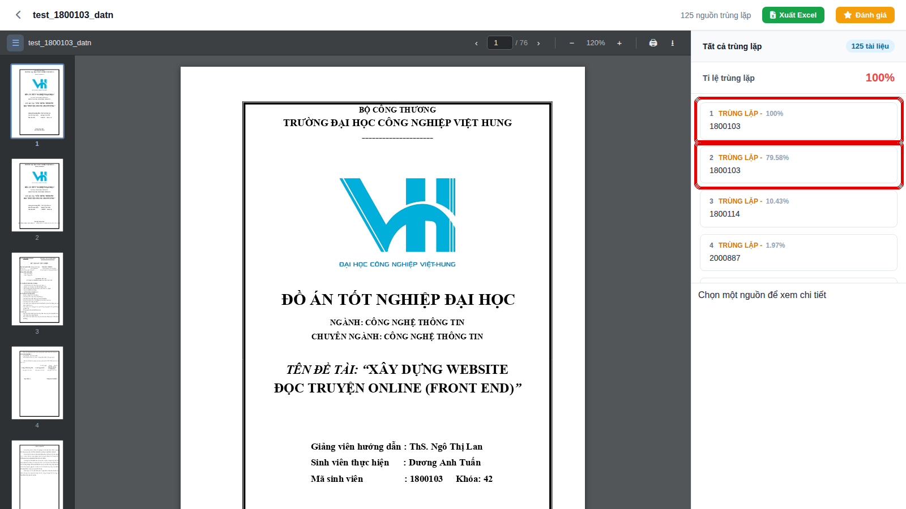
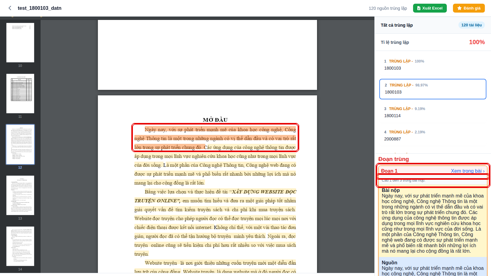
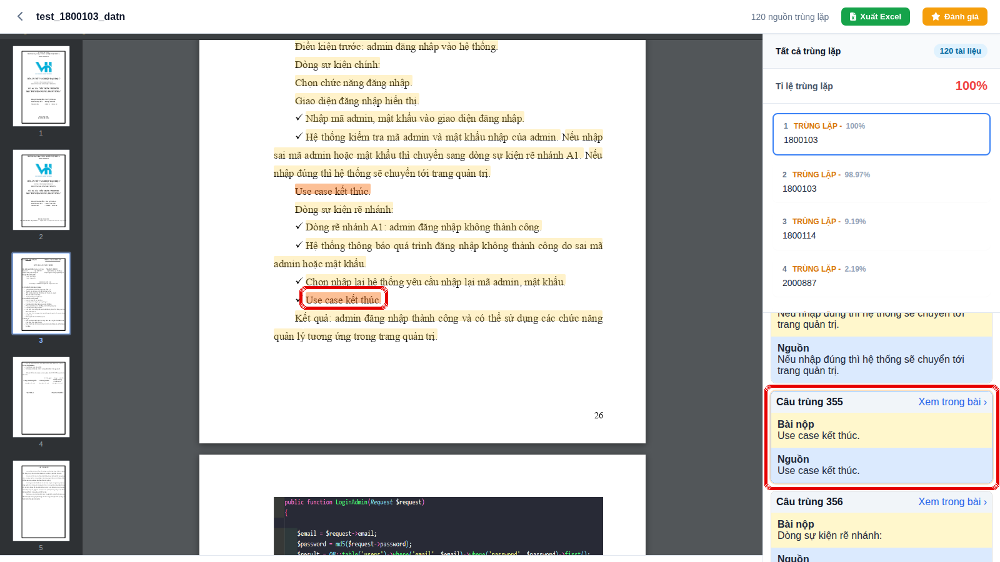

# Báo cáo sửa lỗi 10/10/2026 — tỉ lệ Word/PDF, tách đoạn, xem trong bài

Bộ dữ liệu khách gửi: `bug_new.docx`, `test_1800103_datn.docx/.pdf`, `KetQua_BC69_2026-10-08.xlsx`.
Mẫu đối chiếu trong kho: BC224 = `1800103.docx`, BC225 = `1800103.pdf`.

## Tổng hợp

| # | Lỗi khách báo | Trạng thái | Trước | Sau |
|---|---|---|---|---|
| 1 | Một vài chỗ bấm "Xem trong bài" không xem được | Đã sửa | 204/1162 nút không nhảy được | 0/1363 (Word), 0/1355 (PDF) |
| 2 | Word và PDF cho tỉ lệ khác xa (PDF còn 79.58%) | Đã sửa | Bài Word ↔ mẫu PDF: 79.58% | 98.97% |
| 3 | Lời mở đầu gom thành 1 đoạn, thực tế 3 đoạn | Đã sửa | Cả mục Mở đầu = 1 đoạn | 3 đoạn (DOAN_001–003) |
| 4 | Bắt đoạn trùng bỏ qua các đoạn phía trước | Đã sửa | Nguồn BC225: 0 đoạn; "Đoạn 1" ở câu 70 | BC225: 78 đoạn, Đoạn 1 = câu 1–3 |
| 5 | Câu rời rạc (gạch đầu dòng) bị gộp vào đoạn trên | Đã sửa | "Khi đời sống…" + các ý bên dưới = 1 đoạn | Mỗi ý là 1 đoạn riêng |

## Nguyên nhân và cách sửa

1. **Xem trong bài** (`workers/processHighlight.js`, `workers/pdfSentenceMapper.js`)
   - Bộ lọc header/footer ước lượng chiều cao trang từ chữ trên trang, nên dòng đầu/cuối thân bài bị coi là header/footer → câu mất vệt bôi màu. Nay dùng chiều cao trang thật.
   - Câu lặp nguyên văn ("Use case kết thúc.") dò ra cùng một chỗ, vệt sau bị bỏ hẳn. Nay gắn thêm câu vào vệt đang có.
   - Câu bắt đầu giữa một dòng dài rồi vắt sang dòng sau không dò ra được do giới hạn vòng quét. Đã nới giới hạn theo độ dài cụm chữ đầu.
2. **Word ↔ PDF lệch** (`utils/dung_doan_van_pdf.js` mới, `utils/trich_xuat_text.js`, `utils/doc_docx_theo_xml.js`, `utils/chuan_hoa_dong_van_ban.js`)
   - PDF dựng lại đoạn chỉ dựa vào chữ: câu kết thúc đúng mép phải bị cắt đoạn, dấu đầu dòng Wingdings bị xoá nên ý liệt kê dính vào đoạn trên. Nay dựng đoạn theo bố cục trang (chạm mép phải, thụt lề, khoảng cách dòng, dấu đầu dòng), header/số trang không cắt ngang đoạn.
   - Bản Word mất ký hiệu danh sách tự động. Nay đọc `numbering.xml`: dấu đầu dòng thì gắn "- ", đánh số thì gắn "1. ", giống bản PDF in ra.
   - Chú thích hình ("Hình 3.11 – …") và đề mục số ("2.5.4 …") không còn bị dán vào câu phía trên.
3. **Tách đoạn** (`utils/tien_xu_ly.js` — `tachDoanVaCau`): trước cắt đoạn theo dòng trống, mà bước trích xuất đã xoá hết dòng trống. Nay mỗi đoạn văn thật là một đoạn (dòng bị Enter giữa câu vẫn được nối lại trước).
4. **Đoạn trùng** (`utils/passage_match.js`, giao diện `chitiet-bang-trung.js`)
   - Chống chồng lấn tính chung cho mọi nguồn: đoạn nào khớp cả bản Word lẫn bản PDF thì chỉ một nguồn giữ được. Nay tính riêng từng nguồn. Tổng số đoạn trùng của bài vẫn đếm không trùng lặp (`demDoanTrungCuaBai`).
   - Giao diện xếp đoạn theo thứ tự trong bài, và bỏ "+1" làm lệch số câu ("Câu 70 đến 124" thực ra là 69–123). Excel đã in đúng số gốc.
5. **Câu rời rạc**: được giải quyết bởi mục 2 và 3.

## Số liệu kiểm chứng

So bộ câu sinh ra từ bản Word và bản PDF của cùng một bài, trên 11 cặp có sẵn trong kho mẫu:

| Bài | Cũ | Mới |
|---|---|---|
| DATN/1800103 | 87.67% | 97.33% |
| DATN/2000741 | 76.90% | 90.50% |
| DATN/1800727 | 85.88% | 92.53% |
| DATN/1800711 | 59.53% | 68.23% |
| DATN/1700288 | 96.61% | 99.09% |
| Trung bình 11 cặp | 87.83% | 92.44% |

Không cặp nào giảm. Phần còn lệch là bảng biểu: bản Word loại bảng khỏi so trùng nhưng bản PDF không nhận ra bảng.

Chấm lại thật bài khách gửi (sau khi dựng lại kho mẫu):

| Bài tải lên | Nguồn BC224 (Word) | Nguồn BC225 (PDF) |
|---|---|---|
| Bản Word, code cũ (BC37) | 100% | 79.58%, 0 đoạn trùng |
| Bản Word, code mới (BC40) | 100%, 79 đoạn | 98.97%, 78 đoạn |
| Bản PDF, code mới (BC41) | 91%, 78 đoạn | 100%, 82 đoạn |

## Ảnh

- Trước — tỉ lệ nguồn PDF 79.58%: 
- Sau — bản Word, nguồn PDF 98.97%: 
- Sau — bản PDF: 
- Sau — Đoạn 1 = câu 1–3, đoạn đầu Mở đầu: 
- Sau — câu lặp "Use case kết thúc." bấm được: 
- Sau — bản PDF, nguồn Word, Đoạn 1 từ đầu bài: 

## Cần làm khi cập nhật lên máy khác

Cách tách câu/đoạn đã đổi nên kho mẫu cũ phải dựng lại, nếu không bài mới sẽ so với câu mẫu tách theo kiểu cũ:

```
node rebuild_file.js
node precompute_cauhinh.js
```

Khoảng 5 phút cho ~700 báo cáo mẫu. Bài đã chấm trước đó giữ kết quả cũ cho tới khi chấm lại.

## Chưa xử lý

- Bảng trong PDF chưa nhận ra được, nên bài PDF vẫn có thêm vài câu lấy từ bảng mà bản Word không có. Thử nhận bảng theo khoảng cách cột thì làm rơi nhầm dòng thường (chữ đặt cạnh hình), nên chưa đưa vào.
- Danh sách đánh số lấy từ style (không đặt `w:numPr` trực tiếp trên đoạn) chưa được gắn ký hiệu.
