# Báo cáo xử lý phản hồi 17/10/2026 — `loi_kem_can_them.docx`

Kiểm thử trên máy local (MongoDB `KiemTraTrungLap`, server + worker chạy thật). Số liệu "trước" đo bằng
mã nguồn commit `7196174` chạy song song (git worktree), cùng dữ liệu, cùng tệp.

## Tổng hợp

| # | Yêu cầu của khách | Trạng thái | Trước | Sau |
|---|---|---|---|---|
| 1 | Đổi `vai_tro` sinh_vien → giang_vien trong CSDL, chạy `node server.js` báo E11000 | Đã sửa | `E11000 … dup key: { id_giang_vien: "GV002" }` | Cấp mã `GV003`, không lỗi |
| 2 | Cột "Người đánh giá" hiện sai mã (mã tài khoản ND…, không theo mã GV/SV đã đổi) | Đã sửa | Giảng viên hiện `ND…`; đổi mã xong vẫn hiện mã cũ | Hiện mã SV/GV **hiện tại**, đổi mã là bảng đổi theo |
| 3 | Bài 2000762: Word 100% nhưng PDF 54.52%; Word 100% mà vẫn có câu không bắt được | Đã sửa | Word 100% (408 câu), PDF 54.83% (747 câu) | Word 100% (414 câu), PDF 99.7% |
| 4 | Bấm "số – tên tài liệu" nguồn → trang mới hiển thị báo cáo nguồn, bôi màu trực tiếp | Đã làm | Chỉ xem được câu trích | Trang `xemnguon.html` mở chính tệp nguồn, tô câu trùng |
| 5 | Quản trị viên thêm báo cáo mẫu (từ máy tính / từ báo cáo đã kiểm tra) + tính toán chỉ báo cáo mới | Đã làm | Phải viết code, chạy tay toàn bộ | Khu "Bổ sung báo cáo mẫu" trên trang Quản lý tài liệu |

## 1. Lỗi E11000 khi đổi vai trò

**Nguyên nhân.** Mã giảng viên mới được tính bằng cách sắp xếp *chuỗi* `id_giang_vien` giảm dần rồi cộng 1.
Từ khi người dùng được tự đổi mã trong trang Tài khoản, có mã như `GV01` xếp sau `GV002` theo thứ tự chữ →
đọc ra số 1 → cấp `GV002` → trùng người đã có → E11000. Lỗi này còn làm dừng cả vòng đồng bộ vai trò lúc
khởi động. Đăng ký tài khoản (ND/SV/GV) dùng cùng cách tính nên cũng có thể dính.

**Sửa.**
- `utils/ma_ke_tiep.js` (mới): chỉ xét mã đúng dạng `TIỀN_TỐ + số`, lấy số lớn nhất theo giá trị số, và kiểm
  tra lại mã chưa ai dùng trước khi cấp. Dùng chung cho `routes/auth.js` (6 chỗ) và `utils/dong_bo_vai_tro.js`.
- `dongBoVaiTroTatCa`: một tài khoản lỗi không còn chặn các tài khoản còn lại.

**Kiểm chứng.** Dữ liệu: GV001, GV002, `GV01` (mã tự đổi); tài khoản ND903 sửa thẳng `vai_tro` sang giang_vien.

- Trước: 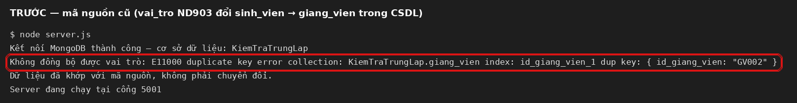
- Sau: 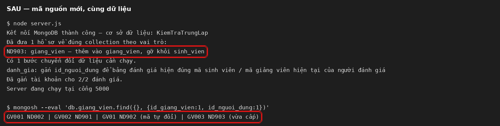

## 2. Mã người đánh giá

**Nguyên nhân.** Đánh giá lưu một *bản chụp* mã lúc gửi vào `id_sinh_vien`: chỉ tra được bảng sinh_vien, nên
giảng viên/quản trị giữ nguyên mã tài khoản `ND…`; và khi người dùng đổi mã sau đó thì bảng vẫn hiện mã cũ.

**Sửa.**
- `models/danh_gia.js`: thêm `id_nguoi_dung` (khoá cố định của tài khoản).
- `routes/danh_gia.js`: lưu `id_nguoi_dung`; khi trả danh sách và xuất Excel thì tra mã **hiện tại**: mã sinh
  viên với sinh viên, mã giảng viên với giảng viên, quản trị viên giữ mã tài khoản.
- Bước chuyển đổi tự chạy `2026-10-17-danh-gia-gan-tai-khoan` gắn `id_nguoi_dung` cho đánh giá cũ (tra cả mã
  ND, mã SV, mã GV). Không cần thao tác tay trên máy khách.
- `thongke-danh-gia.js`: cột Người đánh giá hiện mã mới, di chuột thấy họ tên.

**Kiểm chứng (gọi API thật).** Sinh viên ND005 (SV003) và giảng viên ND901 (GV002) gửi đánh giá, sau đó đổi mã
thành `2200888` và `GVKT01`: cả đánh giá cũ lẫn mới đều hiện mã mới.

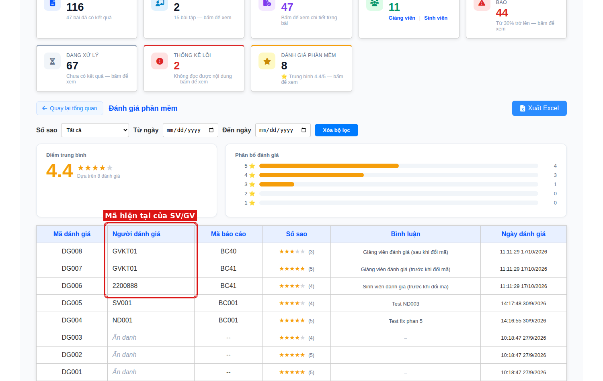

## 3. Word/PDF lệch tỉ lệ và câu không bắt được

**Nguyên nhân 1 — bảng biểu trong PDF.** Bản Word biết đoạn nào nằm trong bảng và loại khỏi so trùng; bản PDF
không có khái niệm bảng nên mỗi ô thành một "câu" vụn ("CREATE TABLE Tạo bảng"…). Bài 2000762 nhiều bảng:
bản PDF ra 747 câu so với 408 câu bản Word, hơn nửa không khớp nguồn → 54.83%.

**Sửa 1.** `utils/nhan_dien_bang_pdf.js` (mới) đọc nét kẻ trên trang PDF, gom nét chạm nhau thành khung; khung
có từ 2 ô trở lên là bảng (khung viền trang bìa bị loại). Chữ trong khung được gắn nhãn BẢNG giống bản Word
(`dung_doan_van_pdf.js`), và không bị nối với dòng khác (`chuan_hoa_van_ban_pdf.js`).

**Nguyên nhân 2 — "Phần mềm…" bị coi là đề mục.** Biểu thức nhận "PHẦN + số La Mã" không phân biệt hoa/thường,
nên "**Phần m**ềm đem đến…" bị đọc thành "PHẦN M" (M = 1000) → câu bị loại như tiêu đề ở cả bài nộp lẫn kho
mẫu. Đây là các câu khách khoanh "không bắt được" (trong `chi_so_cau` của BC263 câu 23 nhảy thẳng sang 24).

**Sửa 2.** `nhan_dien_tieu_de.js`, `loc_vung_tai_lieu.js`: số La Mã chỉ nhận chữ in hoa và phải đứng riêng.
Thêm 5 ca kiểm thử vào `tests/test_tien_xu_ly.js`.

**Số liệu.** Nộp thật qua hệ thống cùng tệp `test_2000762.docx/.pdf` (PDF xuất từ chính tệp Word):

| Bài nộp | Mã cũ | Mã mới |
|---|---|---|
| Bản Word | 100% — 408 câu (thiếu 6 câu "Phần mềm…") | 100% — 414 câu |
| Bản PDF | 54.83% — 747 câu | 99.7% — 341 câu |

So bộ câu Word ↔ PDF trên 12 cặp có sẵn (tỉ lệ câu PDF khớp câu Word): **không cặp nào giảm**.

| Bài | Cũ | Mới |
|---|---|---|
| 2000762 | 45.25% | 99.12% |
| 2000741 | 68.88% | 84.18% |
| 1800648 | 81.59% | 90.48% |
| 1800103 | 93.59% | 99.15% |
| 1800294 | 94.81% | 97.82% |
| 1800727 | 86.74% | 88.16% |
| 6 cặp còn lại | 90.77–99.12% | bằng hoặc cao hơn |

- Tỉ lệ trước/sau: 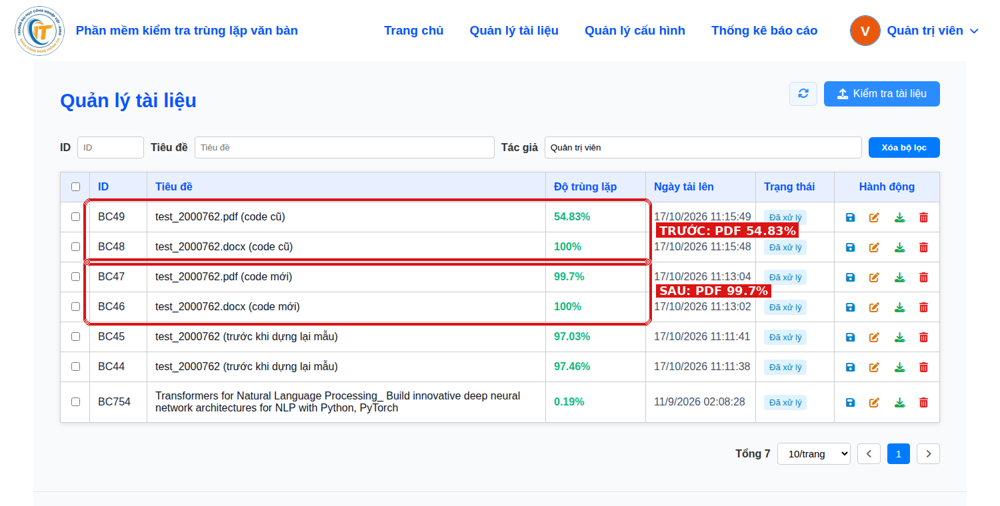
- Trước — 2 câu "Phần mềm…" không được bôi: 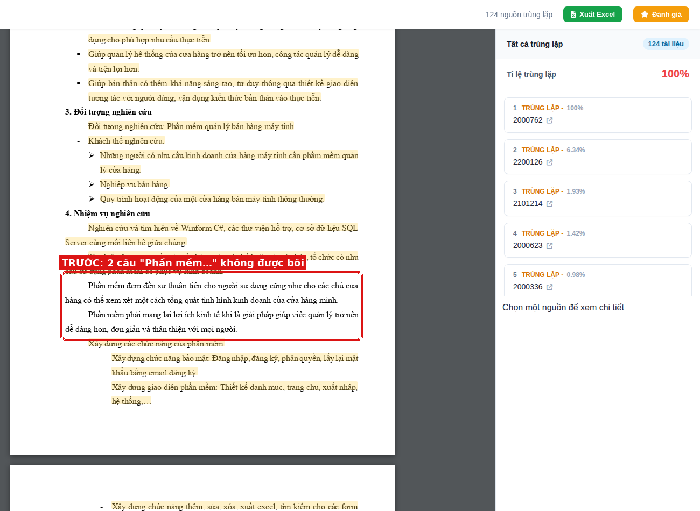
- Sau — đã được bôi: 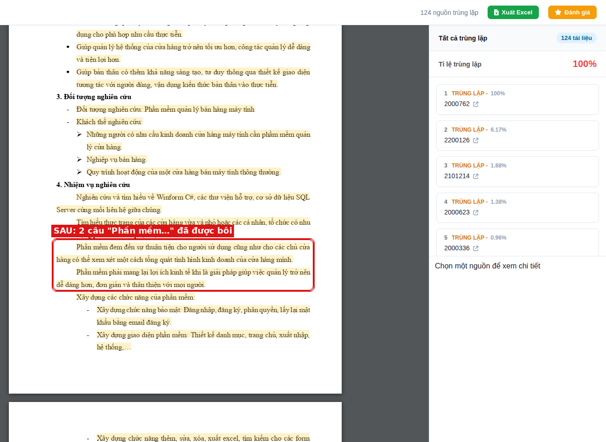

**Việc cần làm khi triển khai:** sửa 2 thay đổi cách tiền xử lý của kho mẫu, nên phải chạy lại **một lần**
`node rebuild_file.js` rồi `node precompute_cauhinh.js` để kho mẫu có lại các câu "Phần m…" và bỏ chữ trong
bảng của các mẫu PDF. Chưa chạy lại thì bài Word vẫn ~97% thay vì 100% (local: 97.46% trước, 100% sau khi lập
lại mẫu BC263). Trên máy local tôi chỉ lập lại BC263 và BC065, chưa chạy lại toàn kho.

## 4. Trang xem báo cáo nguồn có bôi màu

**Làm.**
- Ở cột phải trang chi tiết, "số – tên tài liệu" của mỗi nguồn thành liên kết (di chuột thấy gạch chân + biểu
  tượng), bấm mở tab mới `xemnguon.html?id=<bài nộp>&nguon=<báo cáo nguồn>`. Bấm chỗ khác của thẻ vẫn lọc
  vệt như cũ.
- Trang mới hiển thị **chính tệp báo cáo nguồn** (Word được chuyển sang PDF), tô màu những câu đã trùng với bài
  nộp bằng đúng bộ bôi màu worker dùng cho bài nộp. Cột phải liệt kê từng cặp câu "Nguồn ↔ Bài nộp"; bấm cặp
  câu thì cuộn tới chỗ đó trong nguồn, bấm vệt màu thì cột phải nhảy tới cặp tương ứng.
- Máy chủ: `utils/boi_mau_bao_cao_nguon.js`, API `GET /api/kiem-tra/chi-tiet/:id/nguon/:idNguon` (+ `/document`).
  Vệt được lưu lại (khoá `NGUON_<bài>_<nguồn>`): lần mở đầu ~18 giây (chuyển Word→PDF), các lần sau 0.03 giây;
  chấm lại bài nộp thì vệt tự tính lại.
- CSS trang chi tiết được tách ra `css/chitiet.css` để hai trang dùng chung (giao diện trang chi tiết không đổi).

**Kiểm chứng.** Bài BC47 ↔ nguồn BC263 (2000762): 345 câu nguồn, 920 vệt.

- 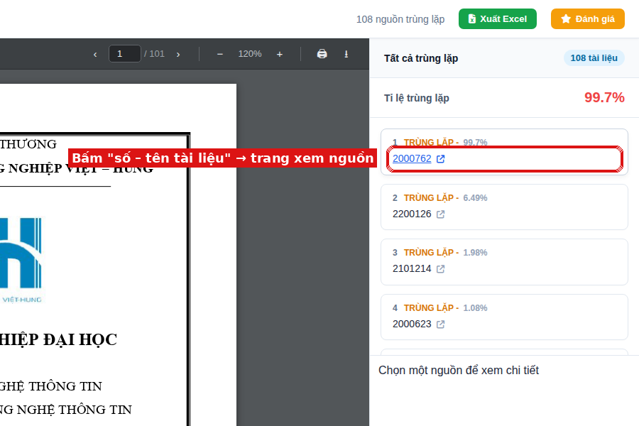
- 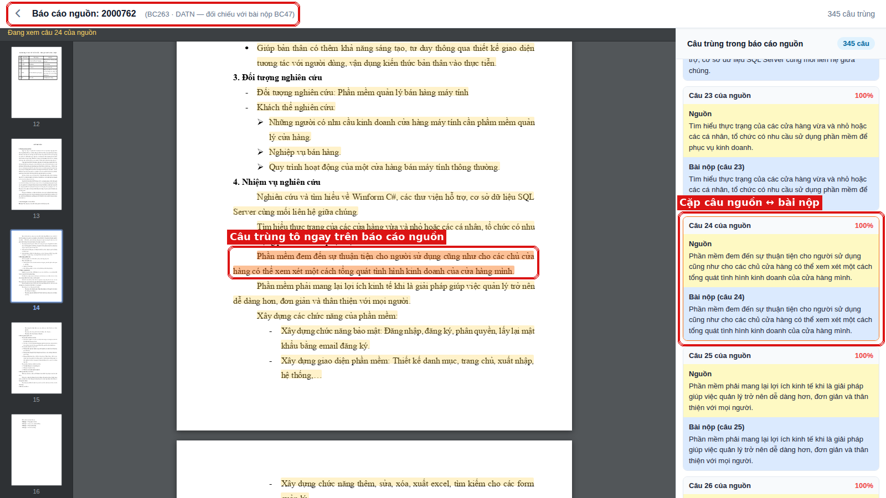

## 5. Bổ sung báo cáo mẫu (chỉ quản trị viên)

**Làm.** Khu "Bổ sung báo cáo mẫu" ngay trước footer trang Quản lý tài liệu, chỉ hiện với quản trị viên (API
cũng từ chối tài khoản khác: 403).
1. Nhập/chọn **Loại báo cáo** (VD `DATN_KS`, gợi ý các loại đang có).
2. Chọn nguồn: **tệp từ máy tính**, **cả thư mục**, hoặc **báo cáo người dùng đã tải lên và có tỉ lệ** (có ô
   tìm; báo cáo đã lấy làm mẫu hoặc mất tệp gốc bị khoá).
3. **Danh sách chờ** để quản trị viên xem lại, bỏ bớt.
4. Bấm **Thêm vào dữ liệu mẫu**: tệp chép vào thư mục mới `nguon_moi_bo_sung/`, bản ghi tạo thẳng trong
   `bao_cao` với `mau_kiem_tra = true` (báo cáo của người dùng được chép thành bản ghi mẫu mới, bản gốc của
   người dùng giữ nguyên).
5. Bấm **Tiền xử lý & tính toán báo cáo mới**: chạy nền, có tiến độ; chỉ xử lý báo cáo `da_tinh_toan = false`.
   Các bước giống hệt `rebuild_file.js` + `precompute_cauhinh.js` nhưng chỉ cho báo cáo mới. IDF của từ đã có
   giữ nguyên (để vector các câu mẫu cũ không lệch), chỉ thêm IDF cho từ mới xuất hiện.
6. Có nút Gỡ cho mẫu thêm nhầm (xoá bản ghi, tệp và chỉ số câu của mẫu đó).

`rebuild_file.js` và `precompute_cauhinh.js` **không sửa**, vẫn dùng để chạy lại toàn bộ.

**Kiểm chứng.**
- Thêm `du_lieu_test.docx` (từ máy tính) và báo cáo BC590 "bug" (từ báo cáo đã kiểm tra) — cả hai trước đó trùng
  0%. Tính toán: 2/2 báo cáo, 10 + 15 câu, thêm 17 từ mới vào IDF; số báo cáo mẫu 604 → 606, mẫu cũ không bị
  đụng tới.
- Nộp lại hai tệp đó: **100%**, nguồn đúng là mẫu mới (BC50, BC51).
- Kết quả lập chỉ số của chức năng mới so với công thức của `precompute_cauhinh.js` trên cùng nội dung: khớp
  209/209 câu (hash, fingerprint, vector TF-IDF).

- 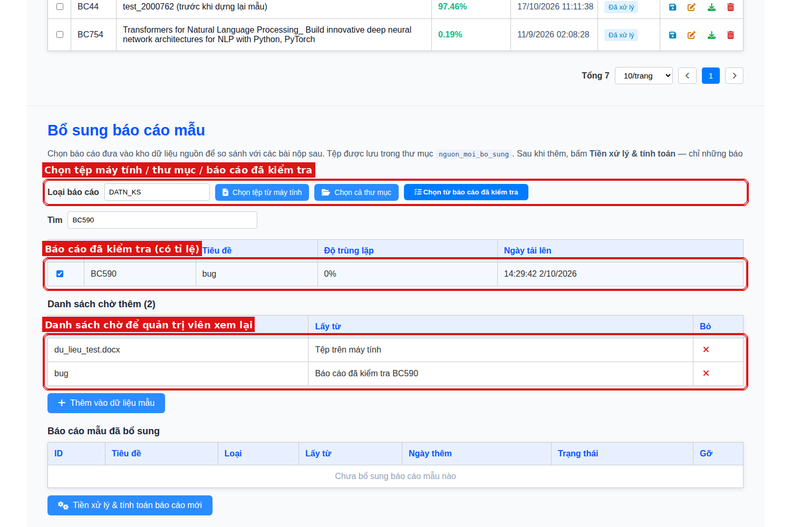
- 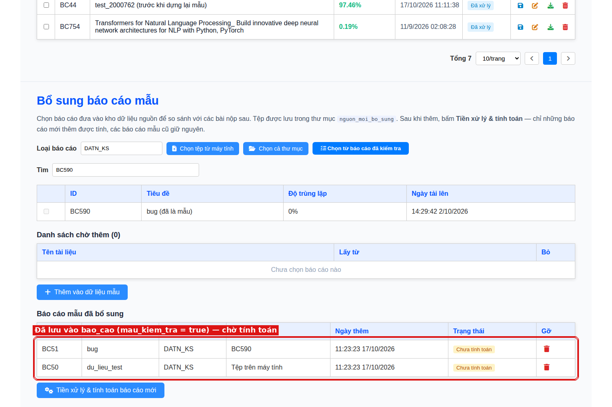
- 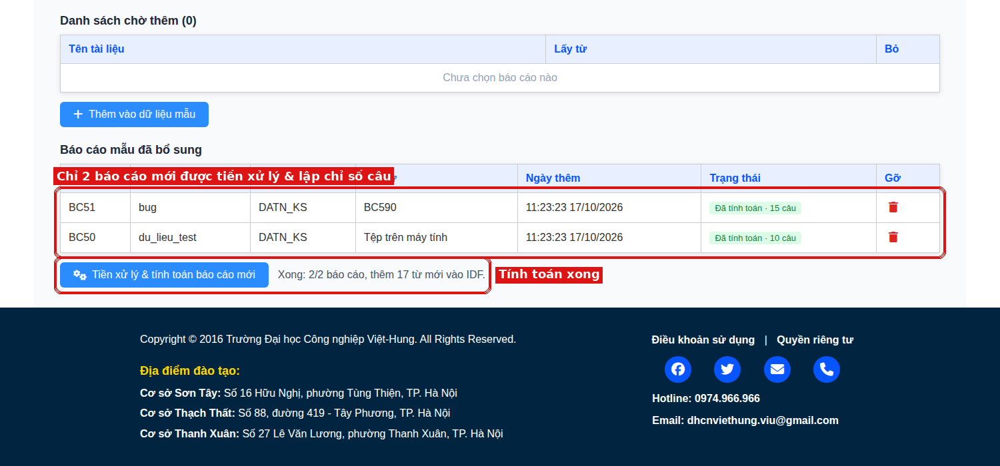
- 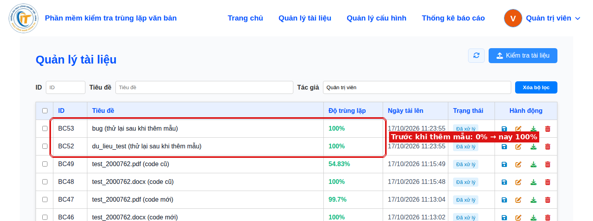
- 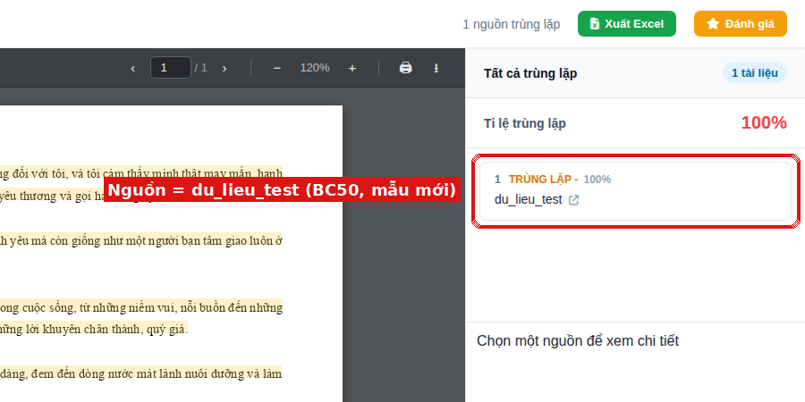

## Khách tự kiểm chứng

1. `git pull`, `npm start` (bước chuyển đổi đánh giá tự chạy), chạy worker như thường.
2. Chạy một lần `node rebuild_file.js` rồi `node precompute_cauhinh.js` (vì mục 3).
3. Nộp lại `test_2000762` bản Word và PDF → so tỉ lệ; mở chi tiết, bấm tên nguồn "2000762" → trang xem nguồn.
4. Đăng nhập quản trị viên → Quản lý tài liệu → cuộn xuống "Bổ sung báo cáo mẫu".

## Hạn chế còn lại

- Bảng PDF **không kẻ khung** thì không nhận ra được (không có nét để dựa vào); bảng Word thì vẫn nhận đúng.
- Bản PDF của khách xuất từ MS Word; trên local tôi tạo PDF bằng LibreOffice từ chính tệp mẫu `2000762.docx`
  (khách không gửi kèm tệp `test_2000762`). Nên nộp lại đúng tệp của khách để đối chiếu.
- API bổ sung mẫu nhận diện quản trị viên qua mã tài khoản gửi kèm (header `x-id-nguoi-dung`), giống cách
  cả hệ thống hiện đang làm (chưa có đăng nhập bằng token). Muốn chặn chắc chắn cần thêm xác thực JWT cho toàn
  bộ API — việc riêng, chưa làm trong lần này.
- Khung đoạn văn có kẻ vạch ngăn trong PDF có thể bị coi là bảng và loại khỏi so trùng.
