# Xử lý phản hồi trong can_chinh_sua.docx (23/10/2026)

Các mục trong tài liệu em gửi được chia làm hai phần:

- **Phần A: lỗi trong mã.** Anh đã sửa và đẩy lên GitHub (nhánh `main`). Em chỉ cần `git pull` về là dùng được. Gồm: tải xuống bài nộp bị sai báo cáo, nộp bài thì báo cáo bị "quét lại", mục 6 (form chọn thư mục) và mục 7 (tô màu khi tìm).
- **Phần B: mục 5 và việc chạy được cả máy cá nhân lẫn server.** Em muốn tự làm để nắm được cách làm, nên phần này anh chỉ vào server để xem hiện trạng (không sửa gì), rồi viết hướng dẫn từng bước để em tự làm.

Ảnh trong tài liệu đều chụp khi chạy thật trên máy anh (backend cổng 5000, giao diện cổng 5500, giống máy em). Chỗ khoanh đỏ là phần đã sửa.

## Tổng hợp

| # | Em báo | Nguyên nhân | Kết quả |
|---|---|---|---|
| 1 | Tải xuống bài nộp ra sai báo cáo | Mã báo cáo bị cấp lại, nên tệp bôi màu cũ cùng mã bị trả nhầm | Đã sửa, tải về đúng tệp đã nộp |
| 2 | Nộp bài thì báo cáo bị quét lại | API nộp bài ghi đè trạng thái "Lỗi" thành "Đã xử lý" | Đã sửa, trạng thái giữ nguyên |
| 5 | Lấy báo cáo người dùng tải lên làm mẫu | Tệp nằm trên máy người tải lên | Hướng dẫn ở phần B |
| 6 | Form chọn thư mục ra giữa màn hình, giống hộp Thông báo | Hộp "Upload N files" là của trình duyệt | Đã làm form mới, có kéo thả |
| 7 | Gõ chữ không tô màu như bên Gửi tài liệu | Ô tìm chưa có phần tô màu và chưa tìm theo ngày | Đã sửa |
| – | Chạy được cả máy cá nhân lẫn server, dùng chung CSDL | | Hướng dẫn ở phần B |

# Phần A. Các lỗi đã sửa trong mã

## 1. Tải xuống bài nộp bị sai báo cáo

**Nguyên nhân.** Khi bấm "Tải xuống", hệ thống ưu tiên trả bản PDF đã bôi màu `upload2/<mã báo cáo>.pdf`. Tệp được chọn chỉ dựa vào tên, mà mã báo cáo lại có thể bị dùng lại:

- Bộ đếm mã báo cáo trong CSDL đứng ở số thấp hơn các mã đang có (trên ảnh em gửi có cả BC75 lẫn BC685). Hàm cấp mã gặp chỗ trống là cấp luôn, tức là cấp lại mã của báo cáo đã bị xoá.
- Mỗi máy chạy backend có thư mục `upload2/` riêng dù dùng chung CSDL. Xoá báo cáo ở máy này thì tệp bôi màu ở máy kia vẫn còn.

Gộp hai điều trên: `test_hinh_anh` nhận lại mã của một báo cáo cũ đã xoá, và nút Tải xuống trả về tệp bôi màu của báo cáo cũ đó. Trước đây chưa bị vì máy em chưa có tệp sót lại nào trùng mã. Từ khi dùng chung CSDL giữa máy em và server thì mới bắt đầu bị.

Anh tái hiện đúng tình huống này: đặt sẵn một tệp bôi màu cũ đúng mã sắp được cấp, rồi tải `test_hinh_anh` (toàn hình) lên, nộp vào bài tập và bấm Tải xuống. Tệp tải về là "Báo cáo thực tập kỹ thuật" dài 73 trang của người khác.

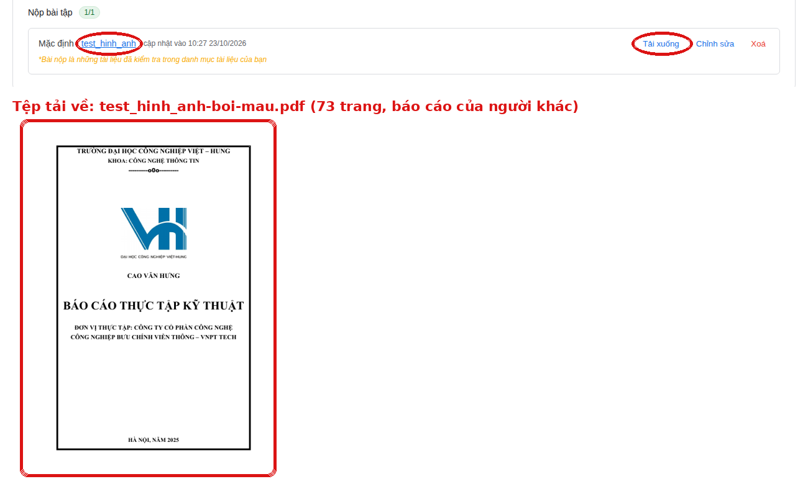

**Nội dung sửa.**

| Sửa | Tệp |
|---|---|
| Chỉ nhận tệp bôi màu được ghi ra **sau** lúc báo cáo hiện tại tải lên. Báo cáo "Lỗi" không bao giờ có bản bôi màu | `utils/tep_boi_mau.js` (mới), `routes/kiemtra.js`, `routes/baocao.js` |
| Không cấp mã có tệp bôi màu sót lại | `utils/tao_ma_bao_cao.js` |
| Bước chuyển đổi tự chạy khi khởi động: nâng bộ đếm lên mã lớn nhất đang có, không cấp lại mã đã xoá nữa | `utils/chuyen_doi_du_lieu.js` |
| Bấm Tải xuống ngay sau khi nộp (chưa tải lại trang) không có tác dụng | `js/thembaitap.js` |

**Kết quả sau khi sửa.** Vẫn đặt sẵn tệp bôi màu cũ như trên. Báo cáo mới được cấp mã khác (bỏ qua mã có tệp sót), và Tải xuống trả về đúng `test_hinh_anh.docx` đã nộp:

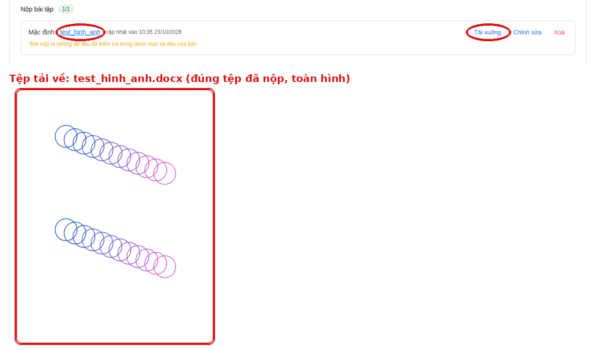

## 2. Nộp bài thì báo cáo bị "quét lại"

**Nguyên nhân.** API nộp bài (`routes/chitietnopbai.js`) ghi đè trạng thái báo cáo thành "Đã xử lý". Báo cáo `test_hinh_anh` toàn hình nên đang ở trạng thái "Lỗi" và không có kết quả chấm. Sau khi bị ghi đè, nó không còn là "Lỗi" mà cũng chưa có kết quả, nên bảng Quản lý tài liệu hiện vòng quay "Đang xử lý", trông như đang quét lại. Thực tế không có lượt chấm nào chạy cả. BC75 và BC683 trên ảnh em gửi đều bị như vậy.

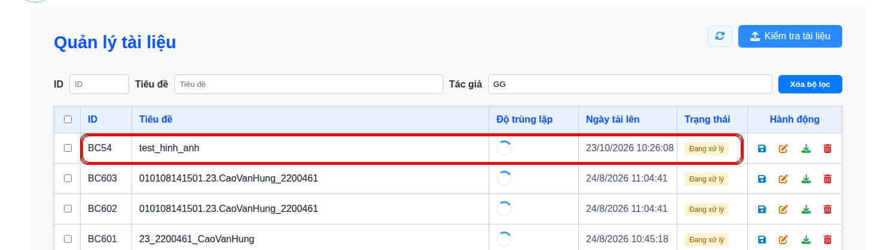

**Nội dung sửa.**

- Bỏ đoạn ghi đè trạng thái trong API nộp bài. Trạng thái chấm chỉ do worker ghi.
- Thêm bước chuyển đổi tự chạy khi khởi động: trả lại "Lỗi" cho các báo cáo đã bị ghi đè (không có chữ, chưa từng có kết quả chấm). Anh đã chạy thử điều kiện này (chỉ đọc) trên CSDL đang dùng trên server của em: đúng 2 báo cáo bị bắt, là **BC75 và BC683**, hai dòng quay vòng trong ảnh em gửi. BC683 là bài em nộp lúc 09:38 23/10. BC75 em từng nộp rồi đổi sang tài liệu khác, nhưng trạng thái bị ghi đè vẫn còn.

**Kết quả sau khi sửa.** BC774 nộp xong vẫn là "Lỗi". BC54 (bị ghi đè từ lần chạy trước) đã được bước chuyển đổi trả về "Lỗi":

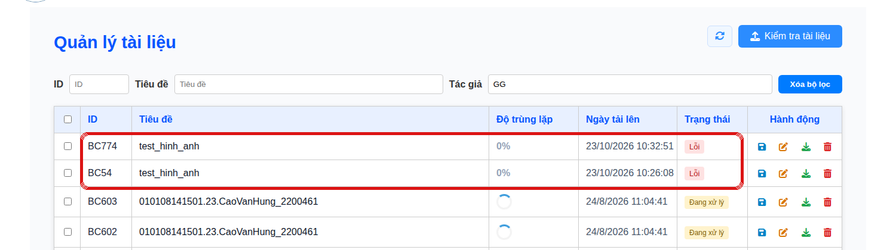

Khi khởi động, backend in ra:

```
🗃️  Có 2 bước chuyển đổi dữ liệu cần chạy.
   → counter bao_cao: nâng bộ đếm lên mã BC lớn nhất đang có ...
      Nâng bộ đếm báo cáo từ 54 lên 772.
   → bao_cao: trả lại "Lỗi" cho báo cáo không đọc được chữ ...
      Trả lại trạng thái "Lỗi" cho 1 báo cáo: BC54.
```

## 3. Mục 6: form chọn thư mục ở giữa màn hình

Hộp "Upload 78 files to this site?" là hộp của trình duyệt. Chrome và Edge luôn hỏi như vậy khi chọn cả thư mục, và trang web không đổi được giao diện hay vị trí của hộp này. Nên anh làm như sau:

- Bấm "Chọn cả thư mục" thì hiện form **"Thêm cả thư mục"** ở giữa màn hình, cùng kiểu với hộp "Thông báo hệ thống!" (dùng chung `js/hop-thoai.js`).
- Trong form có vùng **kéo thả thư mục**. Kéo thả không đi qua hộp chọn tệp nên trình duyệt **không hỏi "Upload N files" nữa**. Hệ thống đọc cả thư mục con và chỉ nhận .docx, .pdf.
- Nút "Chọn thư mục" vẫn mở hộp chọn của máy như cũ, cho ai quen cách đó (đi đường này thì trình duyệt vẫn hỏi).

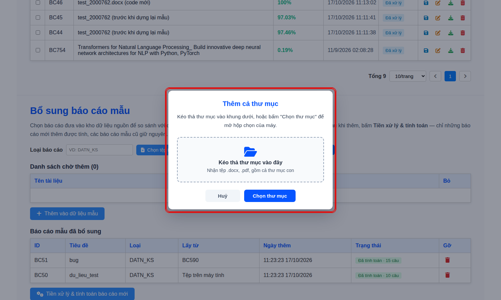

Anh thử thả một thư mục gồm 6 .docx, 1 .txt và thư mục con có 3 .pdf, 1 .txt. Hệ thống báo đã thêm 9 tệp (bỏ 2 tệp .txt), và danh sách chờ có đủ cả 3 tệp trong thư mục con:

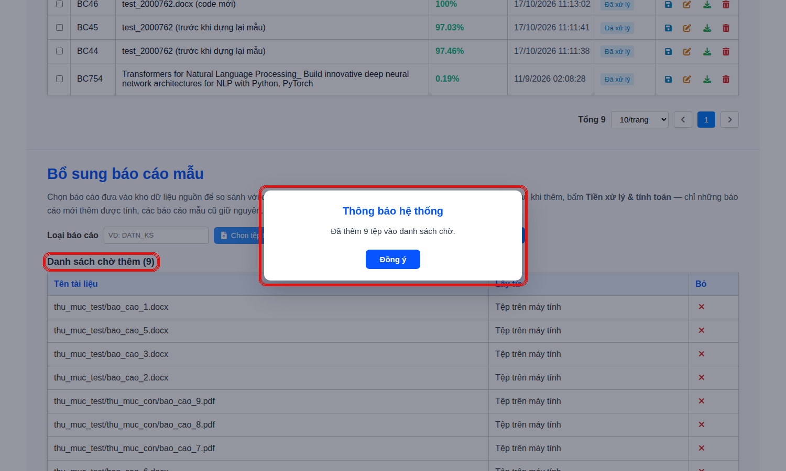

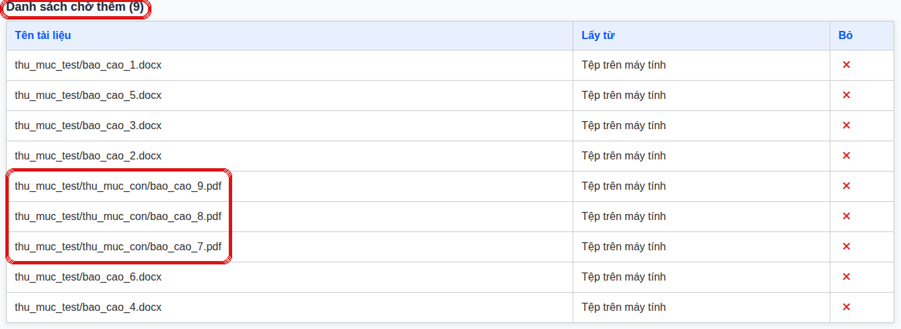

Tệp đã sửa: `js/hop-thoai.js` (nhận thêm nội dung tuỳ biến), `js/quanlytailieu-mau-bo-sung.js`, `css/quanlytailieu.css`.

## 4. Mục 7: tìm kiếm có tô màu như bên Gửi tài liệu

Ô tìm ở "Chọn từ báo cáo đã kiểm tra" giờ giống hệt ô tìm của hộp "Gửi tài liệu" khi nộp bài: có nút "Tìm kiếm", bấm Enter cũng tìm, tìm được theo **ID, tiêu đề và ngày tải lên**, và **tô vàng** phần khớp.

Gõ `bc`. Trước khi sửa không có chỗ nào được tô:

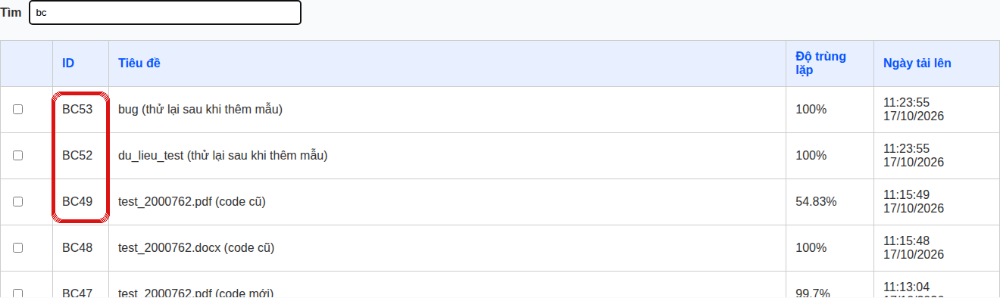

Sau khi sửa, phần khớp được tô vàng:

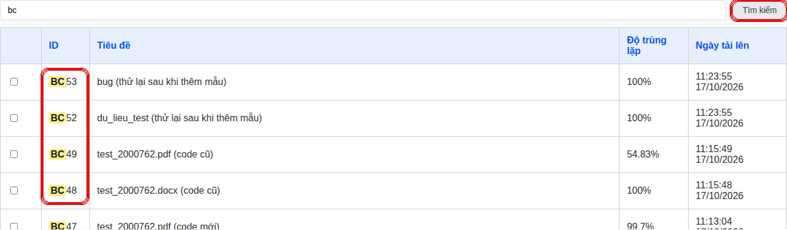

Gõ ngày `17/10`. Trước khi sửa không ra báo cáo nào:

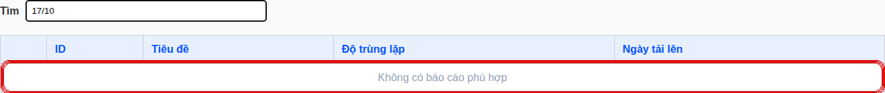

Sau khi sửa ra 8 báo cáo, ngày được tô vàng:

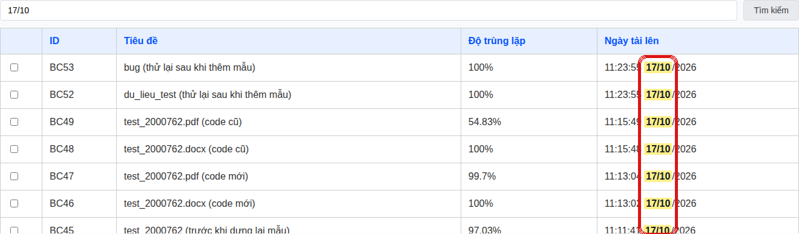

Tệp đã sửa: `pages/quanlytailieu.html`, `js/quanlytailieu-mau-bo-sung.js`, `css/quanlytailieu.css`.

## 5. Cách lấy bản sửa về

1. Mở terminal ở thư mục dự án.
2. Bỏ các chỗ sửa tay trước đó để không bị xung đột khi pull: `git stash`.
3. Lấy bản mới: `git pull origin main`.
4. Khởi động lại backend (`node server.js`) và worker. Lần khởi động đầu, backend tự chạy 2 bước chuyển đổi ở mục 2.
5. Tải lại trang bằng Ctrl + F5.

**Lưu ý.** Máy em và server đang dùng chung một CSDL, nên server cũng phải chạy bản mã mới này. Nếu không, server bản cũ vẫn ghi đè trạng thái khi có người nộp bài. Cách cập nhật server nhanh có ở mục B3.

# Phần B. Hướng dẫn em tự làm

Anh đã vào server (`ssh -p 20101`) để xem thực tế đang chạy thế nào. Anh chỉ chạy lệnh xem, không sửa gì trên server. Hướng dẫn dưới đây dựa trên những gì anh thấy.

## B1. Hiện trạng trên server

| Thành phần | Đang chạy thế nào |
|---|---|
| Thư mục code | `~/kiem-tra-trung-lap-v2`, clone từ repo `hungdeptrai2200461-coder/kiemtra-trunglap-v2` (commit `fe23065 Atlas V2 working version`), cộng thêm **24 tệp sửa tay chưa commit** (đổi địa chỉ API sang `/api`, sửa `config/db.js`...) |
| Backend | pm2 `plagiarism-server`, cổng **20109**, chạy liên tục **từ 16/10**. Tự phục vụ luôn giao diện (`express.static`), nên vào `http://itf.viu.edu.vn:20109/pages/...` là được |
| Worker | pm2 `plagiarism-worker`, chạy từ 15/10 |
| Node | `node-v22.22.0` để ngay trong thư mục code (Node của hệ thống là v18) |
| CSDL backend đang dùng | `.env` trỏ vào **MongoDB Atlas** (`KiemTraTrungLap_V2`) |
| CSDL máy em đang nối | Một `mongod` riêng trên server (`~/mongodb`, cổng 27017, chạy từ 21/10), máy em nối qua `ssh -L` |

Có 4 vấn đề thật:

1. **Atlas đã đầy, không ghi được nữa.** Log backend có lỗi `you are over your space quota, using 513 MB of 512 MB. Writes are blocked on your cluster`. Gói miễn phí của Atlas chỉ có 512 MB, nên tải báo cáo lên server bị lỗi.
2. **Máy em và server đang dùng hai CSDL khác nhau.** Atlas dừng ở BC678 (20/10). `mongod` trên server có thêm 6 báo cáo đến BC685 (23/10), đều là bài em thử ở máy. Em sửa ở máy thì trang trên server không thấy, đúng như em mô tả "không trỏ vào một cái chung nên sửa xong lại lỗi khác". Anh đã so từng bảng: mọi bản ghi trên Atlas đều có trong `mongod`, nên **`mongod` trên server là bản đầy đủ nhất**.
3. **Mật khẩu Atlas bị in ra log.** `config/db.js` dòng 16 trên server có `console.log("URI:", process.env.MONGO_URI)`. Câu lệnh này ghi nguyên chuỗi kết nối kèm mật khẩu vào `worker.log` và log của pm2.
4. **Code trên server cũ và bị sửa tay**, nên mỗi lần cập nhật em phải xoá đi làm lại, mất 2 tiếng.

Ngoài ra còn một tiến trình `python3 -m http.server 5500` chạy từ 9/10 trỏ vào thư mục đã bị xoá, là đồ thừa, tắt đi được.

## B2. Hướng làm: một CSDL duy nhất là `mongod` trên server

- Backend trên server nối thẳng `mongodb://127.0.0.1:27017/KiemTraTrungLap_V2`, ngay trên máy, không qua mạng nên nhanh và không phụ thuộc Atlas.
- Máy em nối vào cùng CSDL đó qua đường hầm SSH **tự chạy, không hỏi mật khẩu** (B5).
- Kết quả: em sửa dữ liệu ở máy thì trang server thấy ngay, và ngược lại.
- Bỏ Atlas, không dùng nữa. Muốn dùng lại Atlas thì phải nâng gói trả phí.

Trước khi làm gì, em **sao lưu cả hai CSDL** trên server:

```
cd ~/mongodb-tools/*/bin
./mongodump --uri "mongodb://127.0.0.1:27017/KiemTraTrungLap_V2" --out ~/sao_luu_mongod_$(date +%Y%m%d)
./mongodump --uri "<MONGO_URI Atlas trong .env>" --out ~/sao_luu_atlas_$(date +%Y%m%d)
```

## B3. Đưa code lên server bằng git (1 phút thay vì 2 tiếng)

Ý tưởng: máy em và server **cùng lấy code từ một repo GitHub**. Em sửa trên máy, test xong thì push. Server chỉ việc `git pull` rồi khởi động lại. Không nén, không xoá thư mục, không sửa tay trên server nữa.

24 tệp sửa tay trên server **không cần nữa**:
- Phần địa chỉ API đã có `js/api-config.js` tự chọn: mở trang bằng `127.0.0.1` thì gọi `127.0.0.1:5000`, mở bằng `itf.viu.edu.vn` thì gọi `itf.viu.edu.vn:20109`.
- Phần CSDL và cổng nằm trong `.env`, mỗi máy giữ một bản riêng.

**Bước 1 (làm trên máy em, một lần): thêm dòng phục vụ giao diện vào `server.js` rồi commit.** Server chỉ mở một cổng 20109, nên backend phải phục vụ luôn giao diện như bản trên server đang làm. Bản trong repo chưa có dòng này. Thêm ngay sau dòng `app.use('/upload2', express.static(path.join(__dirname, 'upload2')));`:

```js
// Phục vụ luôn giao diện để chỉ cần một cổng (server chỉ mở 20109)
app.use(express.static(path.join(__dirname, '010108294906.18.CaoVanHung_2200461')));
```

Chạy thử ở máy: mở `http://127.0.0.1:5000/pages/trangchu.html` phải ra trang chủ. Cách mở bằng Live Server vẫn dùng được như cũ. Sau đó commit và push lên repo em dùng cho server.

**Bước 2 (trên server, một lần): clone bản mới sang thư mục mới, giữ nguyên thư mục cũ để phòng.**

```
ssh -p 20101 hungcaovan_k46@itf.viu.edu.vn
cd ~
git clone <địa chỉ repo của em> kiemtra-moi
cd kiemtra-moi
cp ../kiem-tra-trung-lap-v2/.env .
cp -r ../kiem-tra-trung-lap-v2/uploads ../kiem-tra-trung-lap-v2/upload2 .
cp -r ../kiem-tra-trung-lap-v2/node-v22.22.0-linux-x64 .
export PATH=$HOME/kiemtra-moi/node-v22.22.0-linux-x64/bin:$HOME/.npm-global/bin:$PATH
npm install
```

**Bước 3: sửa `.env` của server** (dùng `nano .env`):

```
PORT=20109
MONGO_URI=mongodb://127.0.0.1:27017/KiemTraTrungLap_V2
```

Giữ nguyên `JWT_SECRET`, `EMAIL_USER`, `EMAIL_PASS`.

**Không chép `.env` từ máy em lên server.** Máy em nối CSDL qua đường hầm ở cổng 27018 (mục B5). Trên server không có cổng đó, nên chép sang sẽ báo `ECONNREFUSED 127.0.0.1:27018`. Mỗi máy giữ một bản `.env` riêng:

| Máy | `MONGO_URI` | `PORT` |
|---|---|---|
| Server | `mongodb://127.0.0.1:27017/KiemTraTrungLap_V2` | `20109` |
| Máy em (đã bật đường hầm) | `mongodb://127.0.0.1:27018/KiemTraTrungLap_V2` | `5000` |

**Bước 4: chuyển pm2 sang thư mục mới, chỉ rõ chạy bằng Node 22.**

pm2 chạy ứng dụng bằng Node của chính nó, không phải Node trong `PATH`. Node đó cũ (dưới 20), trong khi thư viện `mongodb` bản 7 cần Node 20 trở lên. Nếu không chỉ rõ, log sẽ báo `ReferenceError: crypto is not defined` và pm2 khởi động lại liên tục (cột ↺ tăng dần). Vì vậy phải thêm `--interpreter`:

```
NODE22=$HOME/kiemtra-moi/node-v22.22.0-linux-x64/bin/node
$NODE22 -v                     # phải ra v22.x
pm2 delete plagiarism-server plagiarism-worker
pm2 start server.js --name plagiarism-server --interpreter $NODE22
pm2 start workers/worker.js --name plagiarism-worker --interpreter $NODE22
pm2 save
pm2 describe plagiarism-server | grep -i "interpreter\|node.js version"
pm2 logs plagiarism-server --lines 20
```

Dòng `describe` phải ra `node.js version │ 22.x`. Nếu `ls $NODE22` báo không có tệp, chép thư mục Node từ bản cũ sang: `cp -r ~/kiem-tra-trung-lap-v2/node-v22.22.0-linux-x64 .`

Log phải có `Kết nối MongoDB thành công — cơ sở dữ liệu: KiemTraTrungLap_V2` và `Server đang chạy tại cổng 20109`. Lần đầu sẽ có thêm dòng chuyển đổi dữ liệu: nâng bộ đếm báo cáo và trả "Lỗi" cho BC75, BC683. Mở `http://itf.viu.edu.vn:20109/pages/trangchu.html` để kiểm tra.

Lưu ý: tệp `.env` mới vẫn còn mật khẩu email. Đừng bao giờ commit `.env` (repo đã có sẵn trong `.gitignore`).

**Từ lần sau, mỗi lần có code mới**, trên server chỉ chạy:

```
cd ~/kiemtra-moi
git pull
npm install        # chỉ khi package.json thay đổi
pm2 restart plagiarism-server plagiarism-worker
```

Muốn backend tự chạy lại khi server khởi động lại thì chạy `pm2 startup` một lần và làm theo dòng lệnh nó in ra. Lệnh đó cần quyền sudo, không có quyền thì nhờ thầy chạy hộ.

`mongod` hiện được em bật tay (`--fork`), nên server khởi động lại thì nó không tự chạy, backend sẽ báo lỗi nối CSDL. Cho nó tự chạy bằng crontab, không cần sudo. Chạy `crontab -e` rồi thêm một dòng:

```
@reboot $HOME/mongodb/mongodb-linux-x86_64-ubuntu2204-8.0.12/bin/mongod --dbpath $HOME/mongodb-data --logpath $HOME/mongodb-log/mongod.log --fork
```

**Dọn dẹp** (sau khi chạy ổn vài ngày):
- `kill 184553`: tắt `http.server 5500` thừa.
- Đổi mật khẩu user Atlas `hungdeptrai2200461_db_user`, vì nó đã nằm trong log.
- Xoá thư mục `kiem-tra-trung-lap-v2` cũ.

## B4. Mục 5: lấy báo cáo người khác làm mẫu

Hệ thống lưu hai thứ ở hai nơi:
- **Thông tin báo cáo** (tiêu đề, tỉ lệ, đường dẫn tệp) nằm trong CSDL, dùng chung.
- **Tệp .docx/.pdf** nằm trong thư mục `uploads/` của máy chạy backend lúc người đó tải lên.

Cô tải bài lên qua trang trên server thì tệp nằm trên server. Máy em có bản ghi nhưng không có tệp, nên hiện "(mất tệp gốc)" và không cho chọn. Mã không chặn gì cả.

Cách làm:
1. **Cô (hoặc em) bổ sung mẫu trên trang server** `http://itf.viu.edu.vn:20109`. Server có đủ tệp của mọi người tải lên nên chọn báo cáo nào cũng được. Đây là cách chính, dùng cả khi bảo vệ.
2. Khi cần thử trên máy em, chép tệp từ server về (chỉ thêm, không xoá gì), chạy ở thư mục dự án trên máy em:

```
scp -P 20101 -r hungcaovan_k46@itf.viu.edu.vn:~/kiemtra-moi/uploads/. uploads/
scp -P 20101 -r hungcaovan_k46@itf.viu.edu.vn:~/kiemtra-moi/upload2/. upload2/
```

CSDL lưu đường dẫn đầy đủ của máy tải lên, nhưng backend đã có hàm `timTepBaoCao` (`utils/duong_dan_tep.js`) dò lại theo tên tệp trong `uploads/` của máy đang chạy. Nên chép tệp về đúng thư mục là đủ, không phải sửa CSDL.

## B5. Nối CSDL từ máy em mà không phải mở shell riêng

1. Tạo khoá SSH trên máy em (một lần), mở PowerShell: `ssh-keygen -t ed25519` (bấm Enter hết).
2. Đưa khoá lên server (một lần, đây là lần cuối phải nhập mật khẩu):

```
type $env:USERPROFILE\.ssh\id_ed25519.pub | ssh -p 20101 hungcaovan_k46@itf.viu.edu.vn "mkdir -p ~/.ssh && cat >> ~/.ssh/authorized_keys && chmod 600 ~/.ssh/authorized_keys"
```

Thử lại `ssh -p 20101 hungcaovan_k46@itf.viu.edu.vn`: không hỏi mật khẩu là đúng.

3. Tạo tệp `mo_csdl.bat` ở thư mục dự án. Tệp này tự nối lại khi rớt mạng:

```
@echo off
:lap
ssh -N -o ServerAliveInterval=30 -o ExitOnForwardFailure=yes -p 20101 -L 27018:127.0.0.1:27017 hungcaovan_k46@itf.viu.edu.vn
timeout /t 5 >nul
goto lap
```

4. `.env` trên máy em: `MONGO_URI=mongodb://127.0.0.1:27018/KiemTraTrungLap_V2`, `PORT=5000`.
5. Cho Windows tự chạy đường hầm khi bật máy: bấm `Win + R`, gõ `shell:startup`, tạo shortcut tới `mo_csdl.bat` trong thư mục vừa mở. Từ đó em chỉ cần `node server.js` như bình thường.

**Lưu ý khi dùng chung CSDL:**
- Thử ở máy là ghi thẳng vào dữ liệu thật trên server. Đừng xoá báo cáo hay lớp thật khi thử.
- Máy em và server phải chạy **cùng bản code**. Pull bản mới lên server ngay sau khi push, vì backend tự chuyển đổi dữ liệu khi khởi động.
- Chỉ nên chạy **một worker** cho một CSDL: worker trên server đã nhận việc chấm từ Redis của server. Worker ở máy em dùng Redis ở máy em, chỉ chấm bài tải lên từ máy em, như vậy không sao. Nhưng tệp bôi màu khi đó nằm ở `upload2/` máy em, server không có.

## B6. Khi bảo vệ, nếu server nghẽn mạng

1. Trước buổi bảo vệ, chép một bản CSDL về máy em. Trên máy em, khi đường hầm đang chạy:
   `mongodump --uri "mongodb://127.0.0.1:27018/KiemTraTrungLap_V2" --out sao_luu`
   rồi `mongorestore --uri "mongodb://127.0.0.1:27017" sao_luu`. Chép luôn `uploads/`, `upload2/` như B4.
2. Để sẵn tệp `.env.offline` với `MONGO_URI=mongodb://127.0.0.1:27017/KiemTraTrungLap_V2`.
3. Nếu server nghẽn: đổi `.env.offline` thành `.env`, chạy `node server.js` và worker, mở trang bằng Live Server. `api-config.js` thấy `127.0.0.1` nên tự gọi backend trên máy em, không phải sửa code.
